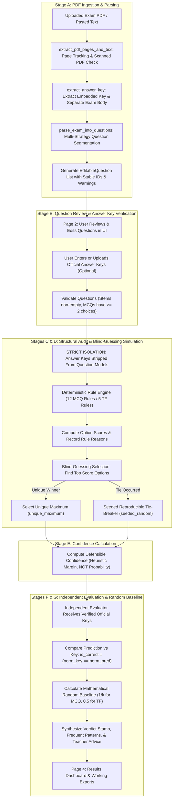

# EL-HABBED — Pipeline, Architecture, Scoring Point System & Four-Page UI Specification

> **System Name:** EL-HABBED (Deterministic Exam Auditor & Blind-Guessing Simulator)  
> **Architectural Philosophy:** 100% Deterministic Rule Engine — **Strictly Zero AI / Zero LLMs / Zero Vector DBs / Zero Machine Learning**.  
> **Core Premise:** Investigate whether answer-writing patterns (length disparity, qualifying hedge words vs. absolutes, grammatical matching, option similarity, and antonym pairs) enable predicting exam answers without understanding the subject matter, and compare predictions against an official answer key and an exact mathematical random guessing baseline.

---

## Table of Contents
1. [Product Vision & Dual Objectives](#1-product-vision--dual-objectives)
2. [Complete Project Structure](#2-complete-project-structure)
3. [The 4-Stage Logical Pipeline](#3-the-4-stage-logical-pipeline)
   - [Stage A: PDF Ingestion, Text Extraction & Question Parsing](#stage-a-pdf-ingestion-text-extraction--question-parsing)
   - [Stage B: Official Answer Key Isolation & Verification](#stage-b-official-answer-key-isolation--verification)
   - [Stage C: Deterministic Structural Auditor](#stage-c-deterministic-structural-auditor)
   - [Stage D: Blind-Guessing Engine & Seeded Tie-Breaker](#stage-d-blind-guessing-engine--seeded-tie-breaker)
   - [Stage E: Confidence & Score Separation](#stage-e-confidence--score-separation)
   - [Stage F: Independent Evaluation Against Official Key](#stage-f-independent-evaluation-against-official-key)
   - [Stage G: Mathematical Random Baseline & Exam Findings](#stage-g-mathematical-random-baseline--exam-findings)
4. [Heuristic Scoring Point System](#4-heuristic-scoring-point-system)
   - [4.1 MCQ Rules Engine (12 Rules)](#41-mcq-rules-engine-12-rules)
   - [4.2 True/False Rules Engine (5 Rules)](#42-truefalse-rules-engine-5-rules)
   - [4.3 Order-Independence & Ablation Support](#43-order-independence--ablation-support)
5. [Tie-Breaking Mathematics & Reproducibility](#5-tie-breaking-mathematics--reproducibility)
6. [Expected Random Guessing Baseline Calculation](#6-expected-random-guessing-baseline-calculation)
7. [The Four-Page UI Workflow](#7-the-four-page-ui-workflow)
   - [Page 1: Upload Exam](#page-1-upload-exam)
   - [Page 2: Review Parsed Questions & Provide Answers](#page-2-review-parsed-questions--provide-answers)
   - [Page 3: Analysis Loading ("HABBED" Pipeline)](#page-3-analysis-loading-habbed-pipeline)
   - [Page 4: Exam Analysis Results Dashboard](#page-4-exam-analysis-results-dashboard)
8. [API Data Contracts & Schemas](#8-api-data-contracts--schemas)
9. [Automated Verification Test Suite (21 Tests)](#9-automated-verification-test-suite-21-tests)
10. [Execution & Deployment Guide](#10-execution--deployment-guide)

---

## 1. Product Vision & Dual Objectives

**EL-HABBED** serves two independent, decoupled objectives:

1. **Structural Audit:** Analyze question stems and answer distractors to identify structural vulnerabilities (length disparity, absolute qualifiers, grammatical cues) that make questions vulnerable to test-taking heuristics.
2. **Blind-Guessing Simulation:** Answer every valid, answerable question using strictly the question stem, choices, and question type (with zero knowledge of subject matter or answer keys), then independently evaluate the algorithm's accuracy against the official answer key and the mathematical random baseline.

### Strict Non-AI Constraint
The entire engine strictly prohibits:
- Any OpenAI / Anthropic / Google LLM APIs.
- Machine learning embeddings, vector stores, or classifiers.
- External knowledge graphs or search engines.
- External databases (zero SQL/NoSQL runtime storage).

All parsing, segmentation, feature extraction, scoring, confidence calculations, and teacher remediation advice are implemented using deterministic Python algorithms, regular expressions, and sequence matching. Controlled pseudo-randomness is used exclusively for tie-breaking.

---

## 2. Complete Project Structure

```
ELHABEED/
├── backend/
│   ├── .venv/                         # Python 3.10 virtual environment
│   ├── models/
│   │   ├── __init__.py
│   │   ├── question.py                # Pydantic models for single question analysis & reasons
│   │   └── exam.py                    # Pydantic models for editable questions, audit, & baseline metrics
│   ├── parser/
│   │   ├── __init__.py
│   │   ├── question_parser.py         # Regex parsers for individual MCQ choices & TF statements
│   │   └── exam_parser.py             # Page-level PDF extractor, scanned detector, question segmenter
│   ├── rules/
│   │   ├── __init__.py
│   │   ├── rule_engine.py             # Orchestrator with ablation support running rules sequentially
│   │   ├── mcq_rules.py               # 12 order-independent scoring rules for Multiple Choice
│   │   └── tf_rules.py                # 5 order-independent scoring rules for True/False
│   ├── services/
│   │   ├── __init__.py
│   │   ├── analyzer.py                # Question-level scoring & seeded random tie-breaker
│   │   └── exam_service.py            # Answer-key isolated audit, evaluation, & baseline calculation
│   ├── tests/
│   │   ├── test_mcq_scoring.py        # MCQ scoring, longest answer, moderate/absolute words tests
│   │   ├── test_tf_scoring.py         # TF scoring, negation, reason words, default rule tests
│   │   ├── test_tie_breaking.py       # Seeded random tie-breaking, variation, reproducibility tests
│   │   ├── test_answer_key_isolation.py # Automated proof that official keys never leak into predictions
│   │   ├── test_evaluator_and_baseline.py # Evaluation & random baseline (1/k and 50%) tests
│   │   ├── test_exam_parser.py        # Parser, warnings, and scanned PDF detection tests
│   │   └── test_full_exam_audit.py    # Full CS101 benchmark PDF end-to-end integration test
│   └── main.py                        # FastAPI application entry point, CORS, and REST endpoints
│
├── frontend/
│   ├── src/
│   │   ├── components/
│   │   │   ├── Page1Upload.tsx        # Page 1: Drag-and-drop PDF upload, type filter, sample loader
│   │   │   ├── Page2Review.tsx        # Page 2: In-place editable question cards & official key manager
│   │   │   ├── Page3Loading.tsx       # Page 3: 5-stage HABBED pipeline loading display
│   │   │   ├── Page4Results.tsx       # Page 4: Evidence-based dashboard, baseline comparison chart
│   │   │   ├── ExamAuditPanel.tsx     # 4-Page wizard coordinator
│   │   │   ├── QuestionForm.tsx       # Single question marker form
│   │   │   └── ResultsPanel.tsx       # Single question marker results card
│   │   ├── pages/
│   │   │   └── HomePage.tsx           # Shell with top brand bar, tab toggle, and how-it-works
│   │   ├── services/
│   │   │   └── analyzer.ts            # TypeScript API client & interface typings
│   │   ├── App.tsx                    # Root application wrapper
│   │   ├── main.tsx                   # React DOM entry point
│   │   └── styles.css                 # Vintage-academic paper aesthetic styling
│   ├── index.html
│   ├── package.json
│   ├── tsconfig.json
│   └── vite.config.ts
│
├── scripts/
│   └── dev.mjs                        # Concurrent process supervisor: boots FastAPI & Vite simultaneously
├── generate_mock_exam.py              # ReportLab utility script generating real CS101 benchmark PDFs
├── CS101_Programming_Midterm_Exam.pdf # Generated 12-question benchmark exam with known answer keys
├── package.json                       # Monorepo root scripts (`npm run dev`, `npm run backend`, `npm run frontend`)
└── PIPELINE_STRUCTURE_AND_SCORING.md  # System specification documentation
```

---

## 3. The 4-Stage Logical Pipeline



---

## 4. Heuristic Scoring Point System

### 4.1 MCQ Rules Engine (12 Rules)

All choices begin with an initial score of `0`. Each rule inspects the question stem and the set of choices, applying score deltas and generating audit reasons.

| # | Rule Name | Function Name | Score Delta | Condition & Logic | Lexicons / Thresholds |
|---|---|---|:---:|---|---|
| **1** | **Longest Answer** | `longest_answer_rule` | **+3** (Unique Top) <br> **+1** (Unique 2nd) | Ranks choices by character length. If a single choice strictly exceeds all others, it receives +3. If a 2nd choice is strictly longer than all remaining choices, it receives +1. If top choices tie in length, **no points are awarded** (eliminates earliest-option bias). | Character length `len(choice)` |
| **2** | **Moderate Word** | `moderate_word_rule` | **+3** | Fires for each choice that contains any recognized hedging qualifier. | `usually`, `often`, `generally`, `sometimes`, `many`, `most`, `can`, `may`, `typically`, `frequently` |
| **3** | **Absolute Word Penalty** | `absolute_word_penalty_rule` | **-4** | Penalizes choices containing extreme, rigid qualifiers that are almost never factually valid in academic tests. | `always`, `never`, `all`, `none`, `only`, `every`, `must`, `entirely`, `best`, `worst` |
| **4** | **Similar Option** | `similar_option_rule` | **+1** each | Compares all choice pairs $(i, j)$ using `SequenceMatcher.ratio()`. If similarity $\ge 0.72$, both choices get +1 (examiners frequently cluster the correct answer with a near-twin distractor). | Ratio $\ge 0.72$ |
| **5** | **Outlier Rule** | `outlier_rule` | **-3** | Evaluates questions with $\ge 4$ choices. Calculates each choice's average similarity to all other choices. If the lowest average similarity is $< 0.25$ AND is separated from the next lowest by $> 0.12$, it is penalized as an obvious distractor. | Avg similarity $< 0.25$ and gap $> 0.12$ |
| **6** | **Most Inclusive** | `most_inclusive_rule` | **+3** | Extracts content words (`len > 2`, non-stopwords). If a choice's word set is a strict superset of another choice's word set, it receives +3 (e.g. *"Stores data, instructions and addresses"*). | Set inclusion: $W_{other} \subset W_{target}$ |
| **7** | **All Of The Above** | `all_of_the_above_rule` | **+5** (Plausible) <br> **+2** (Standard) | Order-independent: If a choice contains `"all of the above"`, checks if at least 2 companion choices exhibit plausible descriptive indicators ($\ge 4$ words or moderate words without absolutes). If so, awards +5; otherwise awards +2. | Matches `"all of the above"` |
| **8** | **None Of The Above** | `none_of_the_above_rule` | **+2** | If a choice contains `"none of the above"`, awards +2 points. | Matches `"none of the above"` |
| **9** | **Grammar Match** | `grammar_match_rule` | **+3** | Evaluates syntactic congruence between stem and choice: <br> • Stem ending in `"an"` awards +3 to choices starting with vowels `[aeiou]`. <br> • Stem ending in `"a"` awards +3 to choices starting with consonants. <br> • Stem ending in `"is"` / `"was"` awards +3 to singular choices. <br> • Stem ending in `"are"` / `"were"` awards +3 to plural choices (ending in 's'). | Preceding articles `a`/`an` or verbs `is`/`are`/`was`/`were` |
| **10** | **Keyword Overlap** | `keyword_overlap_rule` | **+2** per match | Extracts keywords from question stem (`len > 3`, excluding stopwords, moderate words, absolute words). Awards +2 for each keyword found in a choice. | Matching content word set intersection |
| **11** | **Numeric Extremes** | `numeric_extremes_rule` | **-2** (Extremes) <br> **+1** (Middle) | For questions with $\ge 3$ numerical choices: <br> • Minimum and Maximum numbers receive **-2**. <br> • Intermediate/middle numbers receive **+1**. | Numbers parsed via `-?\d+(?:\.\d+)?` |
| **12** | **Opposite Pair** | `opposite_pair_rule` | **+1** each | If choices contain both polar halves of an antonym pair, awards +1 to both choices (examiners cluster the truth in binary opposites). | `(increase, decrease)`, `(increases, decreases)`, `(enable, disable)`, `(enabled, disabled)`, `(true, false)`, `(before, after)`, `(high, low)`, `(higher, lower)`, `(positive, negative)` |

---

### 4.2 True/False Rules Engine (5 Rules)

Baseline state:
$$\text{True Score} = 0, \quad \text{False Score} = 0$$

| # | Rule Name | Target | Score Delta | Condition & Lexicon |
|---|---|:---:|:---:|---|
| **1** | **Absolute Words Rule** | **False** | **+4** per word | Statements containing rigid absolutes are almost invariably false. <br> Lexicon: `always`, `never`, `all`, `only`, `every`, `must` |
| **2** | **Moderate Words Rule** | **True** | **+3** per word | Statements qualified with realistic softening words are typically true. <br> Lexicon: `usually`, `often`, `many`, `some`, `can`, `may`, `generally`, `typically` |
| **3** | **Reason Words Rule** | **False** | **+2** per word | Questions stating explicit causal rationales often invent false explanations. <br> Lexicon: `because`, `since`, `due to`, `reason` |
| **4** | **Multiple Negatives Rule** | **False** | **+1** per word | Statements with confusing negation words are heavily skewed false. <br> Lexicon: `not`, `cannot`, `isn't`, `aren't`, `won't`, `unlikely` |
| **5** | **Default Rule** | **True** | **+1** | Fires **only** if no other rule was triggered in the entire statement. Tests naturally lean slightly towards true facts. |

---

### 4.3 Order-Independence & Ablation Support

All rules are constructed to be completely independent of execution order. No rule relies on mutable scores written by other rules.  
The engine supports per-rule ablation testing via `disabled_rules`:
```python
def run_mcq_rules(question: str, choices: list[str], disabled_rules: set[str] | None = None):
    # Skips any rule whose function name is in disabled_rules
```

---

## 5. Tie-Breaking Mathematics & Reproducibility

### The Problem of Earliest-Option Bias
Traditional test-taking scripts commonly use `max(scores)` with Python's default behavior, which returns the first element when values tie. This introduces an artificial bias toward Choice A or True.

### The Seeded Random Tie-Breaker
EL-HABBED replaces this bias with a seeded, reproducible tie-breaker that randomizes **only** among the tied top-scoring options:

```python
max_score = max(scores)
tied_indices = [idx for idx, score in enumerate(scores) if score == max_score]
is_tied = len(tied_indices) > 1

rng = random.Random(q_seed)
if is_tied:
    winner_index = rng.choice(tied_indices)
    tie_breaker_method = "seeded_random"
    tied_options = [chr(ord("A") + idx) for idx in tied_indices]
else:
    winner_index = tied_indices[0]
    tie_breaker_method = "unique_maximum"
    tied_options = []
```

#### Invariant Properties:
1. **Never consults the official answer key.**
2. **Reproducible:** Running with identical seed yields identical selections.
3. **Distributional Uniformity:** Running across varied seeds distributes selections evenly across tied options.
4. **Mandatory Prediction:** The algorithm always answers every valid question; it never skips or outputs "undecided".
5. **Clear UI Notice:** When a tie occurs, the results card explicitly informs the user that the selection was made through a blind-guessing tie-breaker.

---

## 6. Expected Random Guessing Baseline Calculation

Fixed threshold claims (e.g. claiming a score of 68% proves a student passed) are unscientific. EL-HABBED computes the exact expected mathematical random baseline for each exam.

### Mathematical Formulation
For any question $i$:
- If MCQ with $k_i$ choices ($k_i \ge 2$):
  $$P_{\text{random}}(i) = \frac{1}{k_i}$$
  *(e.g., 25% for 4 options, 20% for 5 options)*
- If True/False:
  $$P_{\text{random}}(i) = 0.50 \quad (50\%)$$

For an exam evaluated over $M$ verified questions:
$$\text{Expected Baseline} = \frac{1}{M} \sum_{i=1}^M P_{\text{random}}(i) \times 100\%$$

$$\text{Difference in Percentage Points} = \text{Algorithm Accuracy} - \text{Expected Baseline}$$

---

## 7. The Four-Page UI Workflow

### Page 1: Upload Exam
- Branding: *"EL-HABBED — Deterministic Exam Auditor & Blind-Guessing Simulator"*
- Headline: *"Let's see how guessable your exam is."*
- Features:
  - Drag-and-drop PDF upload or switch to paste text.
  - File replacement and file info (filename, size in KB).
  - Question-type filter: "Both (MCQ + T/F)", "MCQ Only", "True/False Only".
  - "Parse Exam" action button.
  - "Try Sample Midterm" loader.

### Page 2: Review Parsed Questions & Provide Answers
- Summary metrics: Total parsed, MCQ count, TF count, Official Keys matched, Needs Review count.
- In-place editable cards:
  - Edit question stem.
  - Edit, add, or delete choices.
  - Toggle question type between MCQ and True/False.
  - Warning callouts for incomplete stems, missing choices, or duplicate numbering.
  - Direct selection of official answer keys on each card ($A-J$ or $\text{True}/\text{False}$).
- Answer Key Status Banner: Clearly states whether keys are provided. Explicitly permits submitting without keys.
- Filter pills: `All`, `MCQ`, `True/False`, `Needs Review`.
- Validation: Verifies stems are non-empty and MCQs have $\ge 2$ choices before submitting.
- Action: "Submit for Analysis" $\rightarrow$ advances to Page 3.

### Page 3: Analysis Loading ("HABBED" Pipeline)
- Headline: *"Your exam is currently being HABBED."*
- 5 visible sequential pipeline steps:
  1. Extracting and validating questions.
  2. Detecting structural answer cues.
  3. Running the blind-guessing algorithm.
  4. Comparing predictions against the official answer key.
  5. Calculating the exam evaluation.
- Animated answer bubbles and error handling with "Retry" and "Return to Review" buttons.

### Page 4: Exam Analysis Results Dashboard
- Evidence-Based Dashboard:
  - Total questions analyzed.
  - Correct predictions (e.g., 10 / 12) and Prediction Accuracy.
  - Comparison Chart: Algorithm Accuracy vs Expected Random Baseline.
  - Difference in percentage points (e.g., +45.0 pts).
  - Cues detected count and percentage.
  - Tied predictions count.
  - Overall evaluation verdict stamp: `LEAKY EXAM`, `MODERATE RISK`, or `ROBUST EXAM`.
- Pattern Findings section: Aggregates most frequent cues (Longest Answer, Absolute Words, etc.) with question counts, percentages, and descriptions.
- Working Actions:
  - **Download Report:** Generates and downloads a complete Markdown audit report.
  - **Export Results:** Downloads complete JSON results payload.
  - **Review Flagged:** Returns to review page or filters to flagged items.
  - **Analyze Another Exam:** Resets wizard back to Page 1.
- Detailed Question Breakdown:
  - Filters: `All`, `Correct`, `Incorrect`, `Cues`, `No Cues`, `Tied`.
  - Expandable question cards with full stems, choices, selected answer badge, tie-breaker notice, official key verification, option score table, and rule audit trail with exact evidence and heuristic limitations.
- Teacher Remediation Advice panel.

---

## 8. API Data Contracts & Schemas

### Endpoints

| Method | Route | Description |
|---|---|---|
| `GET` | `/api/health` | Liveness health check |
| `POST` | `/api/analyze` | Single question analysis with seeded tie-breaker |
| `POST` | `/api/exam/parse` | Stage A: Ingests uploaded PDF, detects scanned status, returns editable questions |
| `POST` | `/api/exam/parse-text` | Stage A: Ingests raw text, returns editable questions |
| `POST` | `/api/exam/audit-reviewed` | Stage B-G: Ingests reviewed questions & official keys, runs audit, simulation & evaluation |
| `POST` | `/api/exam/upload` | Legacy endpoint: uploads PDF and audits in one pass |
| `POST` | `/api/exam/analyze-text` | Legacy endpoint: uploads text and audits in one pass |

---

## 9. Automated Verification Test Suite (21 Tests)

All 21 backend unit and integration tests are automated in `backend/tests/`:

1. `test_mcq_longest_answer_rule`: Verifies longest choice gets +3, 2nd longest gets +1.
2. `test_mcq_moderate_and_absolute_words`: Verifies moderate words (+3) and absolute penalties (-4).
3. `test_mcq_mandatory_prediction`: Ensures every valid question produces a prediction.
4. `test_mcq_order_independence`: Proves rule execution produces identical scores when inverted.
5. `test_tf_absolute_rule`: Verifies absolute words award +4 to False.
6. `test_tf_moderate_rule`: Verifies moderate words award +3 to True.
7. `test_tf_reason_and_negatives`: Verifies causal and negation penalties.
8. `test_tf_default_rule`: Verifies default rule awards +1 to True when no rules fire.
9. `test_mcq_seeded_tie_breaking_reproducibility`: Proves identical seeds produce identical predictions on ties.
10. `test_mcq_different_seeds_produce_variation_on_ties`: Proves different seeds distribute selections across tied choices (no earliest-option bias!).
11. `test_tf_tied_scores_random_selection`: Tests seeded selection on True/False ties.
12. `test_no_tie_when_clear_winner_exists`: Verifies unique maximums are not marked as tied.
13. `test_predictions_do_not_change_when_official_key_changes`: **Proves official keys are 100% isolated and never leak into predictions.**
14. `test_evaluation_reflects_accuracy_accurately`: Tests evaluation of predictions against verified keys.
15. `test_random_baseline_calculation_for_mixed_exam`: Tests baseline math across 4-choice MCQs, 5-choice MCQs, and True/False.
16. `test_missing_and_ambiguous_keys_marked_unverified`: Tests handling of missing keys.
17. `test_no_keys_at_all_reports_accuracy_unavailable`: Tests audit with zero keys.
18. `test_extract_answer_key`: Tests answer key parser regex and normalization.
19. `test_parse_exam_into_questions_with_warnings`: Tests question segmentation and warning flags.
20. `test_scanned_pdf_detection`: Tests scanned PDF detection when text is empty or minimal.
21. `test_full_cs101_mock_exam_audit`: End-to-end integration test auditing the benchmark PDF.

---

## 10. Execution & Deployment Guide

### Run Dev Server (FastAPI + React Vite concurrently)
```bash
npm run dev
```
- **Web UI:** `http://127.0.0.1:5173`
- **FastAPI API:** `http://127.0.0.1:8000`
- **Interactive OpenAPI Docs:** `http://127.0.0.1:8000/docs`

### Run Backend Automated Tests
```bash
backend\.venv\Scripts\python.exe -m pytest -v
```

### Build Frontend
```bash
npm --prefix frontend run build
```
